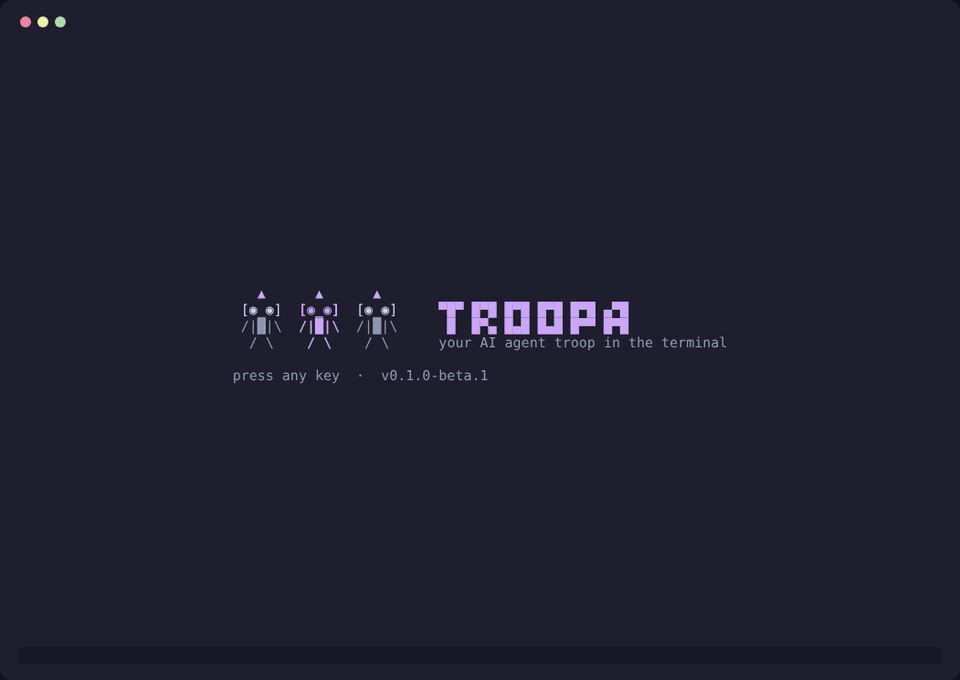

# Troopa

Your AI agent troop in the terminal. Hand each task to Claude Code, Codex, Cursor, OpenCode or Pi in its own git worktree, review the diff, and approve or send it back. Plans run their steps one after the other, even with the terminal closed.



Docs: https://jesusuzcategui.github.io/troopa/docs.html

## Install

Website: https://jesusuzcategui.github.io/troopa/

```bash
# Linux and macOS: latest release, checksum verified, into ~/.local/bin
curl -fsSL https://jesusuzcategui.github.io/troopa/install.sh | sh

# Or with Go 1.26+
go install github.com/jesusuzcategui/troopa/cmd/troopa@latest
```

Every [release](https://github.com/jesusuzcategui/troopa/releases) also ships archives for Linux, macOS and Windows (amd64 and arm64) and `.deb`, `.rpm`, `.apk` and Arch packages:

```bash
sudo apt install ./troopa_*_linux_amd64.deb      # Debian / Ubuntu
sudo dnf install ./troopa_*_linux_amd64.rpm      # Fedora
```

From this repo: `make build` (→ `./bin/troopa`) or `go run ./cmd/troopa`.

Data: `$XDG_DATA_HOME/troopa/troopa.db` (default `~/.local/share/troopa/`).
Config: `$XDG_CONFIG_HOME/troopa/config.toml` (theme, agents, worktrees, terminal and token prices). Troopa only rewrites the keys you change in the setup or in Settings; comments, agents and prices stay as you wrote them.
Per-project checks: `troopa.toml` at the repo root (`checks = ["go test ./..."]`). Plans with auto-approve only approve a step by themselves when checks ran and passed; without checks the step waits in review.

## First run and settings

The first time you open Troopa, a short setup asks for the language, the theme, your default agent and model, your editor, the terminal for pair sessions, the merge strategy and the second brain folder. It lists the agent CLIs it finds on your computer (Claude Code, Codex, OpenCode, Pi) with their versions. Run it again any time with `troopa setup`.

Everything it asks lives in Settings afterwards: press `S` (or Ctrl+K → Settings) to change a value; it is saved to `config.toml` right away. `i` opens About. Moving a task to **ready** always asks before its agent starts, and names the agent.

## Language

The interface is in English by default. Pick Spanish (or follow the system locale with `auto`) in the setup or in Settings; it is stored as `language` in `config.toml`. `TROOPA_LANG=en` or `TROOPA_LANG=es` overrides it. The CLI JSON output and the files written for agents (`TASK.md`, `PAIR.md`) are always in English.

## Themes

Fifteen palettes ship with the binary. Dark: `dark`, `tropic`, `nord`, `dracula`, `gruvbox`, `catppuccin-mocha`, `tokyo-night`, `rose-pine`, `cafe`, `midnight`, `high-contrast`. Light: `light`, `gruvbox-light`, `catppuccin-latte`, `solarized-light`. `t` cycles them. Nord, Dracula, Gruvbox, Catppuccin, Tokyo Night, Rosé Pine and Solarized are adaptations of those community palettes (all MIT licensed), with a few colors adjusted for contrast. The command palette (Ctrl+K) can pick one from a list or write a copy of the current one under `$XDG_CONFIG_HOME/troopa/themes/`.

Drop your own TOML there:

```toml
name = "sunset"

[colors]
fg = "#FFE8D6"
bg = "#2B1B17"
accent = "#FF7A59"
muted = "#A8897A"
selected = "#3D2A24"
status = "#35241F"
error = "#FF5D5D"
diff_add = "#8FBF6A"
diff_del = "#FF5D5D"
diff_hunk = "#7EB8FF"
```

## Agents

`~/.config/troopa/config.toml`:

```toml
language = "en"            # "es", or "auto" for the system locale
default_agent = "claude"   # agent for new tasks ("me" = no agent)
default_model = ""
merge = "squash"           # or "merge"
branch_prefix = ""
worktrees = "~/.local/share/troopa/worktrees"
brain = "~/.local/share/troopa/brain"   # or an existing vault
brain_git = false                       # local commit after writes; never push
max_attachment_mb = 50
notify = true
terminal = "kitty -e"
editor = "nvim"            # or "code", "zed", "code --new-window"…

[agents.claude]
command = "claude"
args = ["-p", "{{prompt}}", "--dangerously-skip-permissions", "--output-format", "stream-json", "--verbose"]

[prices.default]
input = 3
output = 15
cache = 0.3

# Optional: separate agent logins per project (see docs § Accounts)
# [accounts.acme]
# env = { ANTHROPIC_API_KEY = "keyring:" }  # secret in the OS keyring, not here
```

Store API keys in the OS keyring instead of plain text in `config.toml`. Put the marker `keyring:` in the account `env`, then set the secret once (stdin, no echo). Common variables: `ANTHROPIC_API_KEY` (Claude Code), `OPENROUTER_API_KEY`, `GEMINI_API_KEY`, `OPENAI_API_KEY`. The secret never appears in config, logs, TASK.md or CLI output.

```bash
troopa account key set acme ANTHROPIC_API_KEY
troopa account key rm acme ANTHROPIC_API_KEY
```

On the task form and the task panel, `a` opens a file picker (project repo, or home) and `p` accepts a pasted path. Files are copied to `$XDG_DATA_HOME/troopa/attachments/<task-id>/` so the task does not depend on the original (limit `max_attachment_mb`, default 50). The list shows name, type and size; `d` removes with confirmation; `o` opens text in the editor and other files with `xdg-open`/`open`. In the description and criteria, `@` autocompletes tracked files (`git ls-files`; tab/enter completes as `@path`). Launch (and request changes) copies attachments to `.troopa/attachments/` in the worktree (git-excluded, out of the review diff) and lists them in `TASK.md` with `@` references.

Moving a task to **ready** with an agent other than `me` creates a git worktree on `<type>/<slug>` and writes `TASK.md`. **Yolo** runs the CLI non-interactively (live log, then checks and review). **Pair** also writes `PAIR.md` and opens the agent in a tmux split or `terminal`. **Finish pair** (`f`) runs checks. Closing the terminal without finishing leaves **pair-paused**. Approve with `commits=auto` commits, pushes and opens a PR — never merge, never push `main`. `commits=none` leaves the worktree dirty. Discard (`d`) removes worktree and branch.

### Request changes

When the work is not quite right, press `x` in the review (or on the task in the board, the list or the panel) and write what should change. The same agent runs again **in the same worktree**, keeping what it already did, with your feedback in `CHANGES.md` (one round per request; never committed). On the request-changes screen you can attach screenshots: `ctrl+o` asks for a file path, `ctrl+v` grabs an image from the clipboard (Wayland `wl-paste` or X11 `xclip`; without an image it pastes text as usual), `alt+j`/`alt+k` select one in the list and `ctrl+x` removes it. Plain letters always go to the text box. Images are saved as task attachments, copied to `.troopa/attachments/` in the worktree and listed in `CHANGES.md` for the agent. In the review's Changes tab, `j`/`k` move a line cursor on the diff (`n`/`p` change file); `enter` or a click comments that line (real new-file number from the hunk headers). Lines with comments show a mark and the text under the row; `e` edits, `D` deletes, `C` lists pending comments. Requesting changes includes those comments as `path:line`, the quoted line and the note; general text is optional if there are comments. Sent comments are resolved and shown on that round. Each round is stored separately: the Summary tab and the task panel show older rounds folded and the latest open (`r` or click toggles; `[` `]` change round). The **Log** tab (and the live log while the agent runs) formats stream-json into readable lines (`R` toggles raw/formatted, `t` expands thinking). Image attachments and `[image: path]` log lines open in a Kitty/Ghostty/WezTerm popup when supported, otherwise with the system viewer. Pair tasks reopen the interactive agent with the feedback. The diff is still the whole worktree.

Every `TASK.md` asks the agent to start `SUMMARY.md` with a **How to run** section (setup, dependencies, command, how to test), so the review tells you how to try the change. It also includes a **Project context** section with the absolute paths of `project.md` and `INDEX.md` and the Current state / Next / Decisions text. The agent may read the rest of the brain; it must not edit it unless the task says so.

## Daemon and MCP

`troopa daemon` finishes runs and advances plans without the TUI (`install` / `status` / `uninstall`). `troopa mcp` is the MCP server in the same binary. Register it with a client, or print the snippet if that client is missing:

```bash
troopa mcp install claude    # or codex, opencode, cursor
```

`review_approve` needs `[mcp] allow_approve = true`. There is no merge tool; merge stays on `g` in the TUI.

## Second brain

Markdown notes Troopa keeps next to SQLite. Default folder: `$XDG_DATA_HOME/troopa/brain`. The first-run setup and Settings (`S`) pick Troopa's own folder or an existing vault. If the folder is missing, Troopa creates it with this tree:

```
brain/
├── README.md
├── inbox.md
├── today.md
├── projects/
│   ├── INDEX.md
│   └── <slug>/
│       ├── project.md
│       ├── tasks/
│       │   └── <id>-<slug>.md
│       └── guides/
│           └── <YYYY-MM-DD>-<slug>.md
```

Creating or editing a project updates `INDEX.md` and the YAML frontmatter of `project.md` without touching **Current state**, **Next** or **Decisions**. Tasks write `projects/<slug>/tasks/<id>-<slug>.md`. Approving a run appends a History line (HTML id, so it is not duplicated). A local merge (`g`) adds another History line and a guide in `projects/<slug>/guides/` with the **How to run** section of `SUMMARY.md`. `troopa brain sync --json` rebuilds everything from SQLite (idempotent). If `brain_git = true` and the folder is a git repo, Troopa commits locally (`troopa: update <slug>`) and never pushes.

Press `B` from the project list, the board, the task panel or the command palette to read the vault in Troopa. The tree is on the left (inbox, today, `projects/INDEX`, each `project.md`, `tasks/` and `guides/`); the note is rendered with Glamour on the right. A narrow terminal shows one pane at a time (`enter` / `esc`). `tab` cycles `[[wiki]]` and relative Markdown links, `enter` follows them, `esc`/`backspace` go back, and each note lists backlinks. `/` searches every note. `o` opens the current file in your editor; `i` appends a line to `inbox.md`. With `brain_git`, the status bar shows uncommitted changes and `ctrl+s` commits locally. There is no graph view in the TUI.

Rules that apply to every task of a project go in `troopa.toml` at the repo root:

```toml
checks = ["python3 -m pytest -q"]
instructions = """
Python: use a virtual environment in .venv and keep requirements.txt up to date.
"""
```

### After approving

With a remote, Troopa already opened a PR: use `c` to remove the worktree and keep the branch. Without a remote, `g` merges the branch into the project base (squash or merge from `config.toml`) or `c` just cleans the worktree. `d` throws worktree and branch away.

`o` opens the task's worktree in your editor (the project folder when the worktree is gone or the task has none yet). The editor comes from `editor` in `config.toml`, then `$VISUAL`, then `$EDITOR`, then `nvim`/`vim`/`vi`. Terminal editors take over the screen until you quit them; GUI editors open in their own window.

## Keys

`Ctrl+K` command palette (every action). First launch shows a welcome screen.

Projects: `enter` board · `n` new · `e` edit · `a` archive · `c` clients · `F` client filter · `M` metrics · `t` theme · `S` settings · `i` about · `?` help · `q` quit

Clients: `n` new · `e` edit · `a` archive · `enter` client board · `F` filter projects · `esc` back

Board and list: `v` switch board/list · `z` fold the status · `Z` fold empty statuses · `m`/`P`/`A` popup to change status, priority or agent · `tab` task panel · `ctrl+d`/`ctrl+u` scroll the panel · `n` quick task · `e` edit · `enter` open the run (answer, diff, log) or edit a task that never ran · `w` plans · `[` `]` move · `/` search · `f`/`p`/`C` filters · `M` metrics · `g` merge · `x` request changes · `c` clean worktree · `D` delete the task (asks first) · `o` editor · panel `a` attach · `esc` back

On a narrow terminal the board scrolls sideways and follows the selected column (`◀ 2` / `▶ 3` show hidden statuses). From 120 columns the task panel sits beside the board; on smaller terminals `tab` opens it full screen. The view and the folded statuses are saved as `board_view` and `collapsed` in `config.toml`.

Run screen: `tab` or `1` `2` `3` switch tabs: **Summary** (the agent's answer; `j`/`k`, `PgUp`/`PgDn`, `G` scroll), **Changes** (the diff: `j`/`k` line · `n`/`p` file · `enter` comment · `e` edit · `D` delete) and **Log** · `C` comments · `r` fold round · `[` `]` change round · `y` approve · `x` request changes (shows the last answer) · `g` merge · `c` clean worktree · `d` discard · `o` editor. Merged, cleaned and discarded runs open read-only.

Plans: `enter` open the step's run (`esc` back to the plan) · `E` edit the step · `a` add · `K`/`J` move · `s` start · `p` pause · `t` auto · `A` auto-approve · `v` whole goal · `g` merge · `O` PR · `U` pull

Pair: `f` finish · `r` reopen agent · `o` editor · `esc` board (session keeps running)

Mouse: click to select, drag a card to another column, wheel to scroll.

## Releases and website

- `git tag v0.2.0 && git push origin v0.2.0` runs `.github/workflows/release.yml`: tests, then GoReleaser builds every platform, the Linux packages and `checksums.txt`, and publishes the GitHub release. Try it locally with `goreleaser release --snapshot --clean`.
- Before tagging, run `scripts/changelog.sh` and commit `CHANGELOG.md`: it lists every version's commits (features, fixes, other) and the website shows it at `/changelog.html`.
- The website lives in `github_page/` (HTML, CSS and JavaScript built with Vite into `github_page/dist`). `cd github_page && npm install && npm run dev` to work on it; pushing changes to `main` publishes it through `.github/workflows/pages.yml`.

## License

MIT. See [CONTRIBUTING.md](CONTRIBUTING.md).
